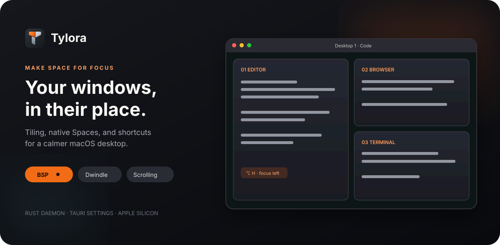
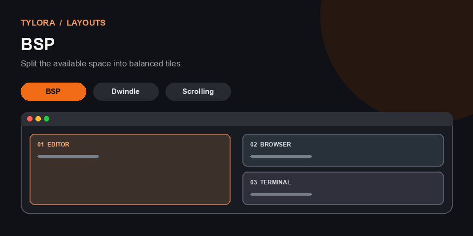

<div align="center">

# Tylora



**A tiling window manager for macOS, built to keep your workspace in order.**

[](https://github.com/Rewqaf41/tylora#requirements)
[](Cargo.toml)
[](apps/gui/README.md)
[](#project-status)

[](https://github.com/Rewqaf41/tylora/releases/latest/download/Tylora_aarch64.dmg)

[Get started](#get-started) · [See the layouts](#see-the-layouts) · [Documentation](#documentation)

</div>

Tylora arranges ordinary windows automatically across your displays. Use keyboard shortcuts or modifier drag to focus, move, resize, and float windows. A small menu bar app and settings window let you configure the Rust daemon without editing TOML by hand.

## See the layouts

<p align="center">
  
</p>

<p align="center"><sub>Illustrated layout behavior; this GIF is not a screen recording.</sub></p>

| Layout        | How it works                                                         |
| :------------ | :------------------------------------------------------------------- |
| **BSP**       | Splits available space into a persistent tree of tiles.              |
| **Dwindle**   | Splits the focused window as new windows appear.                     |
| **Scrolling** | Keeps windows in a horizontal strip; focus brings columns into view. |

Each native macOS Space keeps its own layout state, including split ratios or scrolling widths.

## What you can do

- **Stay on the keyboard.** Focus, swap, resize, float, zoom, and switch layouts with global shortcuts.
- **Use real macOS Spaces.** Bind named workspaces to existing Desktops, switch between them, and move windows after native confirmation.
- **Work across displays.** Tile on every connected display and move a focused window to another display.
- **Make rules and scratchpads.** Place new app windows where you want them and summon a parked window with a hotkey.
- **Tune the experience.** Configure gaps, mouse behavior, focus, animations, rules, and workspaces in the Tauri settings app.
- **Recover windows.** Stop Tylora cleanly or run recovery after a crash to bring back windows it parked or hid.

## Get started

### Requirements

- An **Apple Silicon Mac**. Intel and Universal builds are not tested.
- **macOS 13 or later** is the app bundle minimum. Development and manual validation have been on **macOS 26.3**; behavior on other versions is not established.
- **Accessibility** permission for the app that runs the daemon. Global hotkeys may also need **Input Monitoring**.

### Install the app

1. Use the **Download DMG** button above (after the first release is published), or [build it from source](#build-from-source).
2. Drag **Tylora** into **Applications** and open it. The current downloadable build is ad-hoc signed and not notarized, so macOS may block the first launch. After an attempted launch, open **System Settings → Privacy & Security → Open Anyway** for Tylora. See [release and signing notes](RELEASE.md).
3. Follow the first-run guide: grant Accessibility, review hotkeys, bind any workspaces to Desktops, then start the daemon.

The daemon keeps running when you close the settings window. Use **Stop Tylora** from the menu bar or Dashboard to stop managing windows.

### Build from source

Install Rust stable, Xcode Command Line Tools, and Bun. On a Mac:

```sh
cd apps/gui
bun install
bun run desktop:build
```

The app is written to `target/release/bundle/macos/Tylora.app`; the DMG is in `target/release/bundle/dmg/`. The local build is ad-hoc signed and is not notarized. For development, run `bun run desktop:dev` from `apps/gui`.

## Everyday shortcuts

| Action                             | Default shortcut                           |
| :--------------------------------- | :----------------------------------------- |
| Focus in a direction               | `Option` + `H` / `J` / `K` / `L`           |
| Swap tiles                         | `Option` + `Shift` + `H` / `J` / `K` / `L` |
| Toggle floating                    | `Option` + `F`                             |
| Toggle layout zoom                 | `Option` + `Shift` + `F`                   |
| Switch to a bound workspace        | `Option` + `1`…`9`                         |
| Move a window to a bound workspace | `Option` + `Shift` + `1`…`9`               |

Workspace shortcuts require a matching native Space binding. Shortcuts can be changed in Settings or `~/.config/tylora/config.toml`. See the [technical guide](TECHNICAL.md) for mouse controls and the full command reference.

## Project status

Tylora is **experimental**. Native Space discovery, switching, and window moves use private macOS SkyLight interfaces. Apple can change these in an OS update; unsupported paths fail closed. Tylora does not require disabling SIP, administrator privileges, or code injection.

The former project name was FluxWM. Tylora can import an existing FluxWM configuration on first access; [stop the old daemon first](TECHNICAL.md#configuration-and-migration).

## Documentation

- [Technical guide](TECHNICAL.md) — permissions, configuration, commands, layouts, troubleshooting, migration, and validation.
- [Settings app](apps/gui/README.md) — GUI development and checks.
- [Release guide](RELEASE.md) — packaging, signing, and notarization.
- [Architecture](architecture.md) — internals, state ownership, and known limits.
- [Example configuration](examples/config.toml) — a starting TOML file.
